# MiComunidad

*Community management application by Fabrizio Venegas*

MiComunidad is a mobile application for organizing community information and supporting resident participation.

## Introduction and Motivation

Through my experience in community volunteering, including taking on a coordination role, I became interested in how information about local needs, projects, and agreements is organized and maintained over time. When that information is spread across messages, documents, and meetings, it can be difficult to consult previous decisions, identify priorities, and follow project progress.

This motivated me to develop MiComunidad, a mobile application designed to bring community information into one place and support communication, planning, and follow-up. The application provides different levels of access for residents and administrators, allowing residents to report local issues and administrators to review them alongside ongoing projects and activities.

## Expected Community Impact

**Expected to benefit 90 families.**

MiComunidad is expected to benefit 90 families by bringing community management into one place. The app is designed to help residents and administrators report local issues, follow projects, organize meetings and activities, share photographs and documents, and manage community membership.

<table>
  <tr>
    <td align="center" width="50%">
      
       <em>Community life</em>
    </td>
    <td align="center" width="50%">
      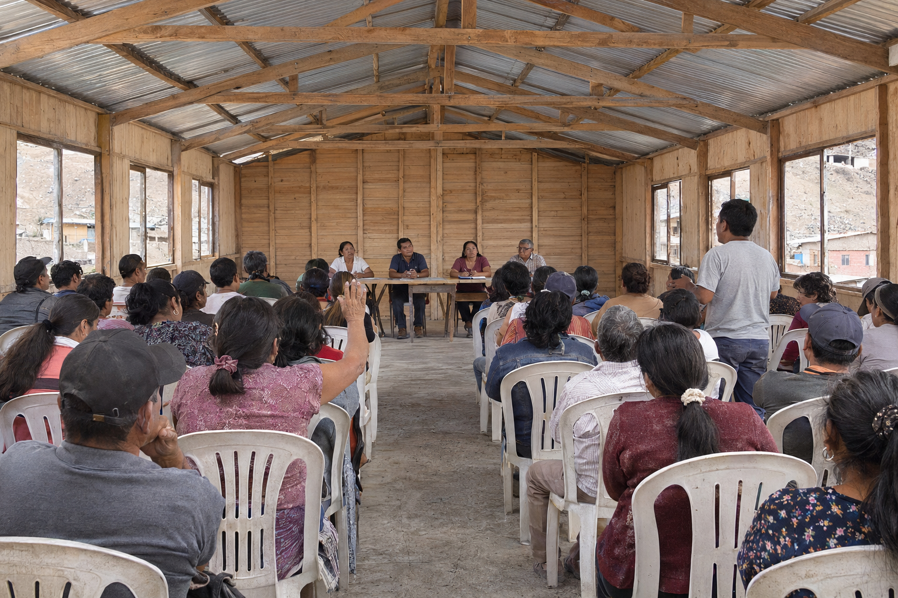
       <em>Planning and participation</em>
    </td>
  </tr>
</table>

*These AI-generated images depict a fictional community and are included for illustration only. They do not show actual residents or locations.*

## My Role and Contributions

I conceived MiComunidad and wrote its initial project proposal, translating community needs into detailed functional requirements. I designed the application’s screen structure, navigation, user roles, and access boundaries, specifying what information each section would display and which actions residents and administrators could perform.

I planned the main workflows for reporting local issues, reviewing submissions, tracking project progress, organizing activities, and managing access requests. As the project developed, I refined these requirements, reviewed the interface, and checked the application’s behavior in emulators and Android builds. I also prioritized separating public and private configurations to reduce the exposure of community information.

## Main Features

- **Access and member management.** Residents request access; administrators review applications and manage membership. Navigation depends on the approved user role.
- **Reports and moderation.** Residents submit issues with descriptions, categories, priorities and optional photos. Administrators review them before operational tracking; completed reports appear in History.
- **Projects and archives.** Projects show progress and supporting content. Administrators manage active projects, archive them and restore them when needed.
- **Interactive map.** Geographic reference points provide context. The public configuration uses fictional coordinates instead of the real community location.
- **Community agenda.** Authorized users consult internal meetings and activities; administrators manage the schedule and associated information.

## Screenshots

These screenshots show the app’s interface populated with fictional demonstration data, not actual community activity. The map uses an unrelated public basemap with an invented boundary and markers; it does not show the community’s location.

### 1. Before Signing In

> **Public access** — Welcome, sign-in, access requests and status lookup.

<strong>View public access screenshots</strong> (4 screens)

<table>
  <tr>
    <td align="center" width="50%">
      <a href="docs/screenshots/resident/welcome.png">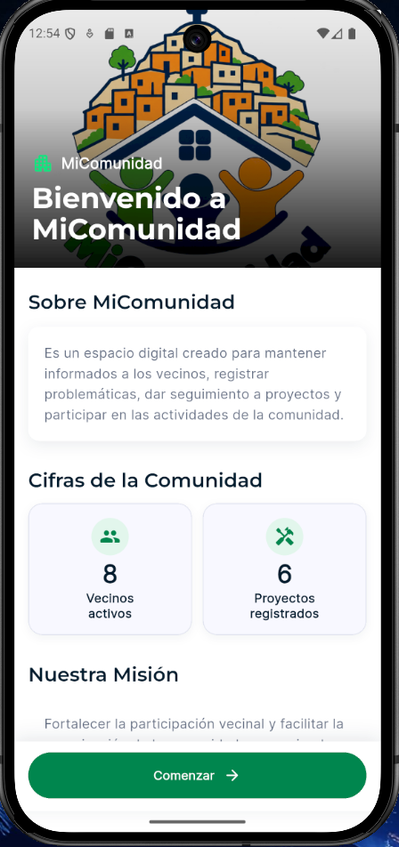</a>
       <em>Welcome screen</em>
    </td>
    <td align="center" width="50%">
      <a href="docs/screenshots/resident/sign-in.png">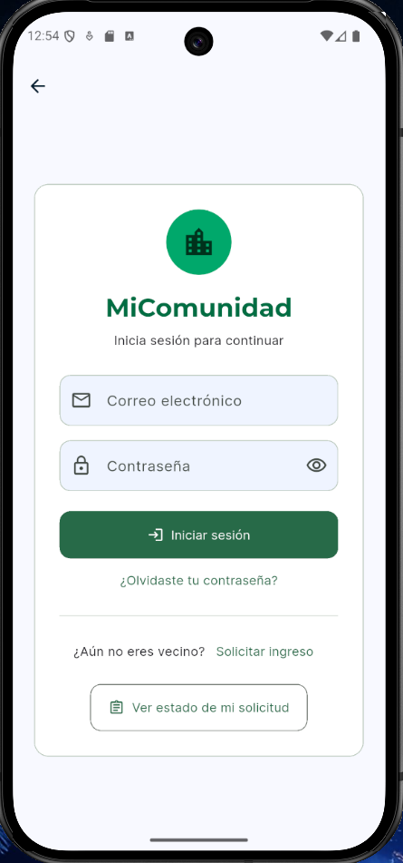</a>
       <em>Sign-in</em>
    </td>
  </tr>
  <tr>
    <td align="center" width="50%">
      <a href="docs/screenshots/resident/access-request.png">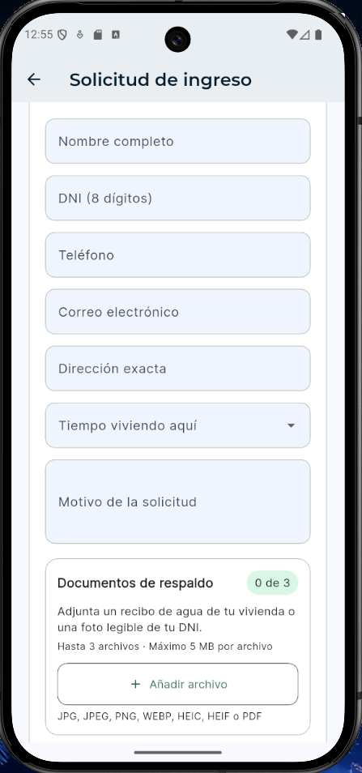</a>
       <em>Access request form</em>
    </td>
    <td align="center" width="50%">
      <a href="docs/screenshots/resident/request-status.png">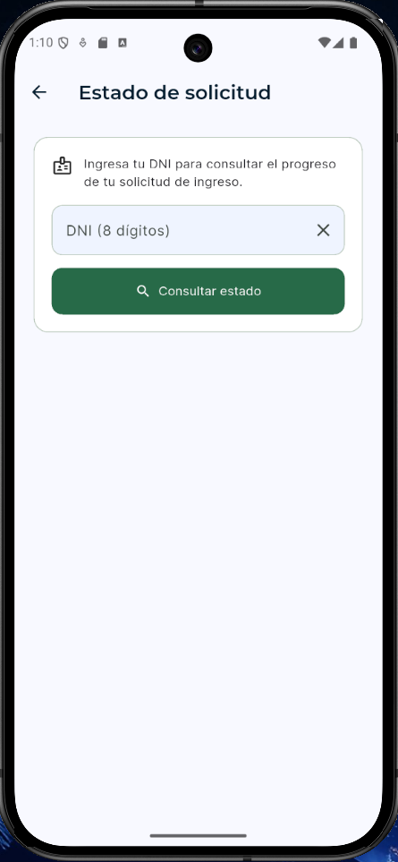</a>
       <em>Request status lookup</em>
    </td>
  </tr>
</table>

---

### 2. Resident Experience

> **Signed in as a resident.**

<table>
  <tr>
    <td align="center" width="50%">
      <a href="docs/screenshots/resident/projects.png">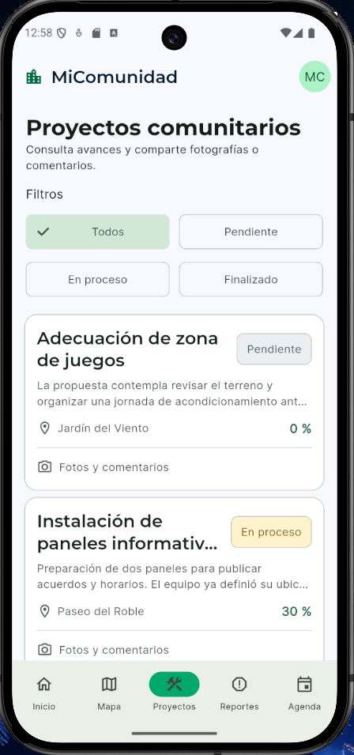</a>
       <em>Projects</em>
    </td>
    <td align="center" width="50%">
      <a href="docs/screenshots/resident/reports.png">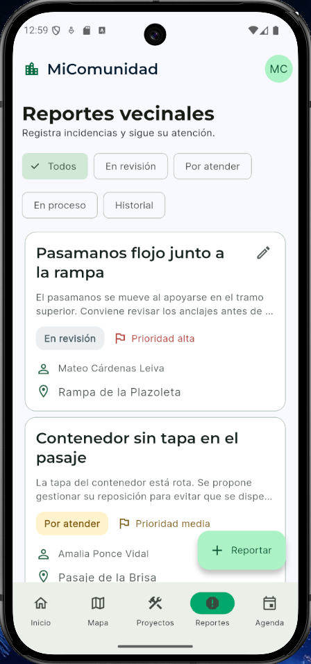</a>
       <em>Report tracking</em>
    </td>
  </tr>
  <tr>
    <td align="center" width="50%">
      <a href="docs/screenshots/resident/map.png">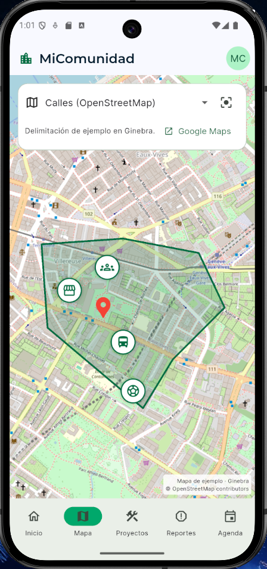</a>
       <em>Interactive map</em>
    </td>
    <td align="center" width="50%">
      <a href="docs/screenshots/resident/agenda.png">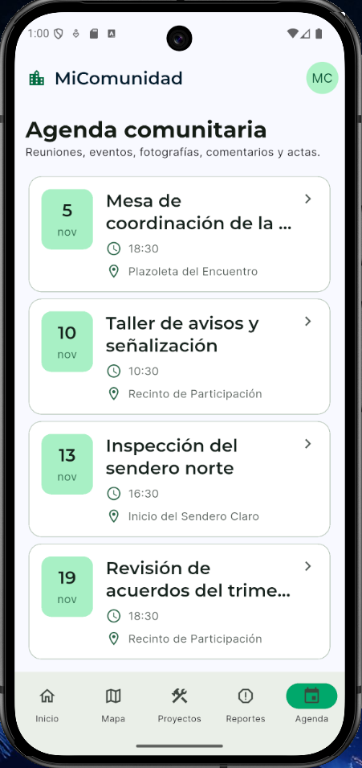</a>
       <em>Community agenda</em>
    </td>
  </tr>
</table>

---

### 3. Administration and Management

> **Signed in as an administrator.**

Administrators can also use the resident features shown above. Their additional permissions allow them to manage access and members, moderate reports, and create or edit projects and agenda activities.

<table>
  <tr>
    <td align="center" width="50%">
      <a href="docs/screenshots/administrator/access-requests.png">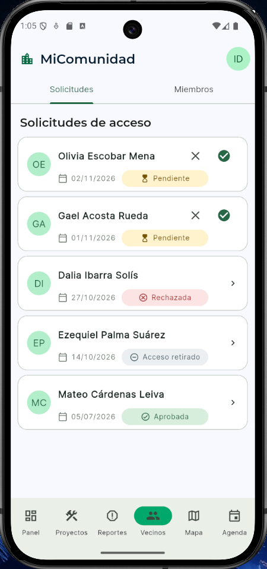</a>
       <em>Access requests</em>
    </td>
    <td align="center" width="50%">
      <a href="docs/screenshots/administrator/members.png">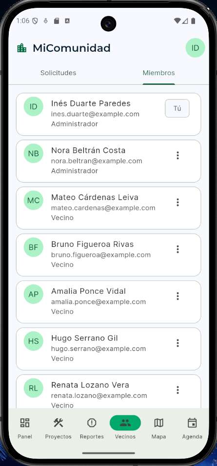</a>
       <em>Members and roles</em>
    </td>
  </tr>
  <tr>
    <td align="center" colspan="2">
      <a href="docs/screenshots/administrator/report-moderation.png">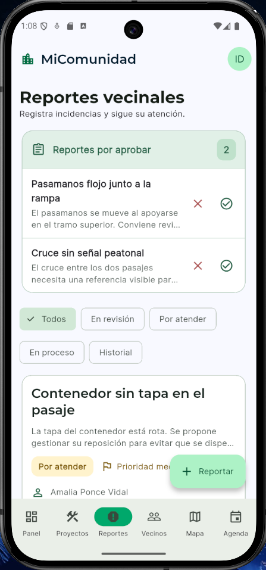</a>
       <em>Reports awaiting approval</em>
    </td>
  </tr>
</table>

## Technical Challenges and Lessons Learned

### Aligning application behavior with Firebase permissions

Residents initially could not see their own pending reports, and Firebase blocked attempts to save report edits. These problems showed that the app and its permissions must work together. I learned that showing a button is not enough: Firebase must also allow the action without giving users access to other people’s information.

### Deleting records and their associated content safely

Deleting a project or report also meant removing its photographs and comments. The process removes this related content first and only deletes the main record once those steps succeed. I learned that deletion must handle errors clearly and allow a safe retry if something goes wrong.

### Preparing a public version while protecting community information

Preparing the project for GitHub meant separating real community names, locations, photographs, and private Firebase settings from the public code. I created separate public and private versions of the app. I learned that excluding a file from GitHub does not guarantee it is excluded from the APK, so both need to be checked before sharing.

## Technologies

- **Flutter and Dart:** The app’s screens, navigation, and how it works.
- **Firebase Authentication:** User sign-in and account authentication.
- **Cloud Firestore:** Stores application information and keeps it updated.
- **Firebase Storage:** Stores photographs and document attachments.
- **Cloud Functions:** Handle tasks such as reviewing access requests and managing members.
- **Firebase Security Rules:** Control who can view or change information and files.
- **OpenStreetMap and OpenTopoMap:** Street and terrain maps, with credit to their creators.
- **flutter_map and latlong2:** Display the interactive map and handle location coordinates.

## Current Project Status

MiComunidad implements the main workflows described above. Using its connected features requires a configured Firebase project with the necessary services and access rules. Without this configuration, the public example builds and starts with a “Firebase not configured” message rather than opening its internal screens.

The public edition uses anonymized examples and keeps real community data and private Firebase configuration separate from the code shared on GitHub.

For build instructions, configuration examples and privacy considerations, see the [setup guide](docs/SETUP.md).
